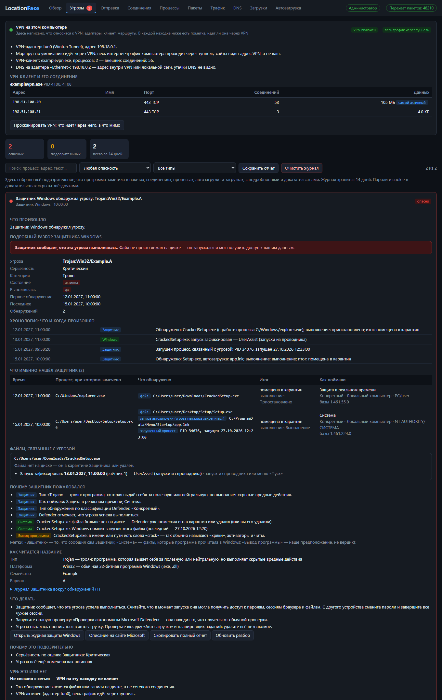
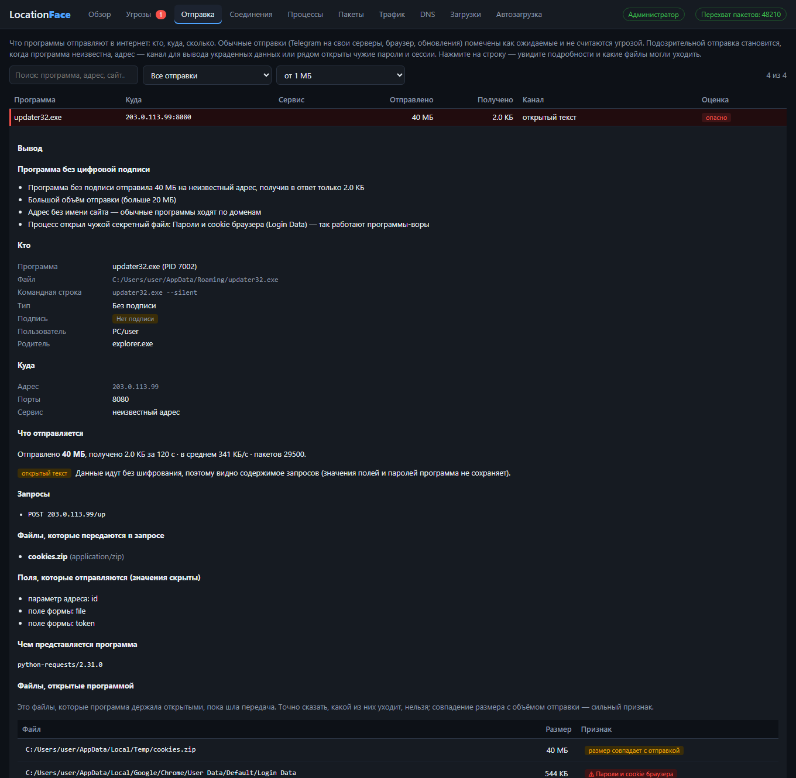
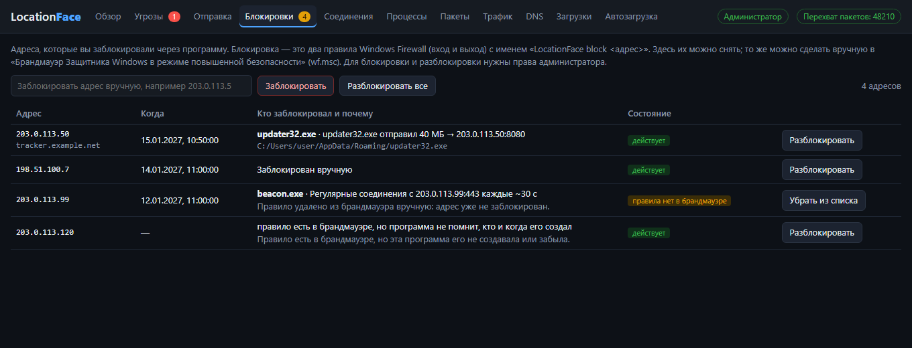

<div align="center">

# Location**Face**

**Монитор сети и безопасности для Windows.**
Показывает, что запущено, куда уходит трафик, что и кому отправляют программы, что скачано, что прописано в автозагрузке, что нашёл Защитник Windows — и объясняет, угроза это или обычная работа.

[](../../releases/latest)


</div>

---

## Зачем это нужно

Обычный диспетчер задач показывает, **сколько** ресурсов тратит программа. LocationFace отвечает на другие вопросы:

- **Куда** эта программа отправляет данные и **что** именно она отправляет?
- Эта отправка нормальная (мессенджер на свои серверы, браузер, обновление) или так выглядит кража?
- Что на самом деле нашёл Защитник Windows, **когда это случилось и что файл успел сделать**?
- Это соединение идёт **через мой VPN или мимо него**?
- Что стоит в автозагрузке и не маскируется ли под системное?

Главная идея — **не пугать ложными тревогами**. Telegram, отправляющий файл на серверы Telegram, не угроза. Незнакомая программа, которая шлёт вам же архив с cookie в Telegram-бота, — угроза. Программа различает такие случаи и объясняет свой вывод.

## Скриншоты

**Угрозы:** панель VPN, подробный разбор находки Защитника (хронология, что найдено, почему пожаловался, что делать) и пометка «через VPN / мимо VPN» в каждой карточке.



**Отправка данных:** кто, куда, сколько и какие файлы могли уходить. Официальные клиенты и браузеры помечены как ожидаемые, неизвестная программа с чужими паролями — как опасная.



## Возможности

### Угрозы
Журнал всего подозрительного с **полными подробностями**: что произошло, почему подозрительно, какой процесс (путь, командная строка, подпись, хеш), куда, доказательства (строки пакетов и дамп данных), что делать. Фильтры, поиск, сохранение отчёта в `.txt`. Журнал хранится 14 дней.

Что отслеживается:

| Признак | Что это значит |
|---|---|
| Пароль без шифрования | логин или пароль уходит по HTTP, FTP или POP3 |
| Сканирование портов, подбор доступа | кто-то перебирает порты, RDP, SSH, SMB |
| Маячок (beacon) | подключения к одному адресу через равные промежутки времени |
| Червь | десятки подключений на порты удалённого доступа за 10 секунд |
| Порты троянов и майнеров | подключение на 4444, 31337, 3333 и подобные |
| Подозрительный DNS | похожие на случайные имена и признаки DNS-туннелирования |
| EXE по HTTP | исполняемый файл скачивается без шифрования |
| ICMP-туннель | необычно большой ping |
| Подозрительная отправка данных | см. вкладку «Отправка» |
| Доступ к чужим секретам | программа открыла пароли браузера, сессию Telegram, токены Discord, кошельки, ключи SSH |
| Защитник Windows | любая угроза из его истории, включая уже удалённые |
| Автозагрузка, загрузки | записи и файлы с признаками вредоносных |

### Разбор находок Защитника Windows
Для каждой угрозы, которую находил Защитник (в том числе уже в карантине), открывается полный разбор:

- **Хронология:** когда обнаружено, в работе какого процесса, какой процесс запущен (PID и время старта), запись автозагрузки, запуски файла по следам Windows.
- **Таблица обнаружений:** объекты, итог (карантин, удаление), выполнялась ли угроза, как поймана, тип обнаружения.
- **Файлы:** путь, размер, даты, подпись, SHA-256, откуда скачан (адрес и страница), файлы, появившиеся рядом.
- **Следы запуска:** Prefetch, UserAssist, BAM — когда Windows видела запуск файла, даже если файл уже удалён.
- **Почему Защитник пожаловался.** Каждое утверждение помечено источником: *Защитник*, *Система* или *Вывод программы*. Программа не выдаёт догадки за факты: например, у суффикса `!rfn` нет официального описания, и так и написано.
- **Расшифровка названия** (`Тип:Платформа/Семейство.Вариант!Суффикс`), журнал событий Защитника вокруг обнаружений, советы, зависящие от находок.
- Кнопки: открыть журнал защиты Windows, описание на сайте Microsoft, **проверить файл Защитником ещё раз (без удаления)**, скопировать отчёт.

### Отправка данных
Для каждой передачи: программа, адрес и имя сайта, сервис, объём отправки и получения, канал (шифрование или открытый текст). В подробностях:

- для HTTP без шифрования — запросы, **имена загружаемых файлов**, названия полей форм и User-Agent (значения полей и паролей не сохраняются никогда);
- **файлы, которые программа держала открытыми** во время передачи; совпадение размера файла с объёмом отправки помечается как сильный признак;
- для HTTPS содержимое прочитать нельзя, и программа честно об этом пишет.

### VPN: это или нет
Программа читает адаптеры, таблицу маршрутов, DNS и соединения VPN-клиентов и в каждой находке пишет:

- **это сам VPN-клиент** (по названию или по драйверу туннеля `wintun.dll` и подобным рядом с программой);
- **узел VPN-клиента** — адрес, с которым он сейчас соединён;
- **идёт через VPN** — маршрут к адресу проходит через адаптер туннеля;
- **мимо VPN** — соединение идёт напрямую, и сервер видит настоящий адрес;
- **VPN не включён**, либо **не связано с сетью** (например, файл на диске).

Кнопка **«Просканировать VPN»** проверяет все текущие соединения: какие программы идут через VPN, какие мимо, и показывает примеры обходящих. Отдельно проверяются настройки DNS (утечка вне туннеля).

### Блокировки: заблокировал — можно разблокировать
Любой внешний адрес можно заблокировать кнопкой в подробностях угрозы, соединения или отправки (или вписать вручную). Все блокировки собраны на отдельной вкладке:

- для каждой видно **кто заблокировал, когда и почему** (программа, причина, путь к файлу);
- **«Разблокировать»** удаляет правила из брандмауэра и считается выполненным, **только если правила действительно исчезли**; иначе программа так и скажет и оставит запись;
- состояние берётся из самого брандмауэра: «действует», «правило отключено», «правила нет в брандмауэре» (кто-то удалил вручную), а правила с именем `LocationFace block …`, о которых программа ничего не помнит, тоже показываются, чтобы их можно было снять;
- повторная блокировка того же адреса не плодит дубли правил;
- «Разблокировать все» и ручная блокировка по адресу.

Блокировка — это два правила Windows Firewall (вход и выход) с именем `LocationFace block <адрес>`; их же можно увидеть и удалить в `wf.msc`.



### Остальные вкладки
- **Обзор** — оценка безопасности ПК от 0 до 100: антивирус и его базы, угрозы и исключения Защитника, брандмауэр, UAC, RDP, SMBv1, прокси, файл `hosts`, администраторы, Secure Boot, процессы, соединения, автозагрузка, загрузки.
- **Соединения** — все TCP/UDP-соединения с процессом, адресом, именем сайта и оценкой риска. Можно заблокировать IP в брандмауэре или завершить процесс.
- **Процессы** — путь, командная строка, родитель, цифровая подпись, SHA-256 (ссылка на VirusTotal), объём трафика.
- **Пакеты** — живой перехват IPv4: DNS-запросы, имена сайтов из TLS (SNI), HTTP-запросы. Клик по пакету открывает заголовки и **дамп данных** (пароли и cookie скрыты звёздочками).
- **Трафик** — сколько каждый процесс принял и отправил на каждый адрес.
- **DNS** — какие имена запрашивались и кеш DNS Windows.
- **Загрузки** — что скачано за 45 дней и **откуда** (адрес файла и страницы по метке Windows `Zone.Identifier`), подпись, двойные расширения вроде `invoice.pdf.exe`.
- **Автозагрузка** — реестр, папки «Автозагрузка», службы вне Windows, планировщик заданий, подмена оболочки (Winlogon), перехват через IFEO. Закодированные команды PowerShell **расшифровываются и показываются**.

## Как программа отличает угрозу от обычной работы

Любая отправка данных оценивается по нескольким признакам, а не по одному:

1. **Официальный клиент сервиса.** `Telegram.exe` с подписью Telegram → серверы Telegram — это нормально. Безымянная программа → Telegram-бот — подозрительно. Так же с Discord (вебхуки), анонимными файлообменниками, pastebin, туннелями и динамическим DNS.
2. **Браузеры и известные производители** отправляют то, что делаете вы сами.
3. **VPN и прокси** пропускают через себя трафик других программ, поэтому большие отправки для них норма.
4. **Односторонность.** Кража почти всегда односторонняя; стрим, звонок, игра и синхронизация обмениваются данными в обе стороны и выгрузкой не считаются.
5. **Чужие секреты.** Если программа, не являющаяся владельцем, открыла пароли браузера, сессию Telegram, токены Discord, кошелёк, ключи SSH или файл с паролями — это опасно независимо от остального. Владельцы и антивирусы исключены.
6. **Закодированные команды PowerShell** оцениваются по содержимому скрипта: скачивание и запуск, отключение защиты — опасно; уведомление или настройка — нет.
7. **«Это моя программа — доверять».** Кнопка в подробностях. Доверие привязано к размеру и дате файла и **снимается автоматически**, если файл заменили.

## Приватность и безопасность самой программы

- **Данные не покидают компьютер.** Программа не обращается к интернету сама. Исключение — ссылки на VirusTotal и сайт Microsoft: они открываются только по вашему клику.
- **Локальный интерфейс.** Окно — это страница с локального сервера на `127.0.0.1` со случайным портом и одноразовым ключом доступа; другие программы и сайты без ключа к нему не подключатся.
- **Перехват без драйвера.** Пакеты читаются через raw-сокеты Windows (`SIO_RCVALL`), без Npcap и без установки драйверов. Нужны права администратора; запрос появляется при запуске.
- **Секреты скрываются до сохранения.** Значения `password=`, `Authorization`, cookie и токенов заменяются звёздочками ещё в памяти, поэтому не попадают ни в журнал, ни в отчёт.
- **Что записывается на диск** (`%APPDATA%\LocationFace`): `incidents.json` (журнал угроз, 14 дней), `trusted.json` (программы, которым вы доверяете), `blocked.json` (кто, когда и почему заблокировал адрес).
- **Что меняет в системе.** Только по вашему клику: правила брандмауэра `LocationFace block <ip>` (кнопка «Заблокировать», снимаются на вкладке «Блокировки») и завершение процесса. Файлы программа **сама не удаляет**.

## Установка и запуск

1. Откройте [**Releases**](../../releases/latest) и скачайте `LocationFace.exe` из блока **Assets**.
2. Запустите и подтвердите запрос Windows о правах администратора.
3. Окно откроется в Microsoft Edge или Google Chrome в режиме приложения (если их нет, в браузере по умолчанию). Закрыли окно — программа завершилась.

> **SmartScreen** может предупредить о неизвестном издателе: файл не подписан цифровой подписью. Нажмите «Подробнее» → «Выполнить в любом случае». Вы можете собрать программу из исходников самостоятельно (см. ниже); SHA-256 готового файла указан в описании релиза, чтобы проверить, что скачанный файл не повреждён.

**Требования:** Windows 10 или 11, права администратора (без них не работают перехват пакетов, чтение чужих процессов и часть проверок), Edge или Chrome для окна.

## Сборка из исходников

Нужен [Go](https://go.dev/dl/) 1.26 и Windows.

```powershell
git clone https://github.com/facetracecompany-ui/LocationFace.git
cd LocationFace
go build -ldflags "-H=windowsgui -s -w" -o LocationFace.exe .
```

Тесты:

```powershell
go test ./...
```

Тесты проверяют разбор пакетов (DNS, TLS SNI, HTTP, FTP), все детекторы, систему доверия, расшифровку PowerShell, определение VPN по таблице маршрутов, сборку отчёта Защитника из его журнала, блокировки на подменённом брандмауэре (нет дублей правил, разблокировка не врёт, расхождения с брандмауэром видны) и то, что секреты не попадают в дамп. Тест чтения открытых файлов процесса работает по-настоящему на запущенной системе.

## Структура проекта

| Файл | Назначение |
|---|---|
| `main.go` | запуск, запрос прав, локальный HTTP-сервер и API, действия |
| `conns.go` | соединения и процессы, оценка риска, цифровые подписи, имена сайтов |
| `sniffer.go` | перехват пакетов, разбор DNS/TLS/HTTP, детекторы атак и вредоносного поведения |
| `harvest.go` | что видно об отправке в открытых протоколах (без значений полей) |
| `trust.go` | модель доверия: сервисы, официальные клиенты, VPN-клиенты, вердикт по отправке |
| `openfiles.go` | файлы, открытые процессом, и поиск доступа к чужим секретам |
| `transfers.go` | сборка вкладки «Отправка» и инцидентов из неё |
| `incidents.go` | журнал угроз, хранение, скрытие секретов, дамп пакета |
| `defender.go` | полный разбор находок Защитника: журнал, хронология, следы запуска |
| `vpn.go` | VPN: адаптеры, маршруты, DNS, клиенты, вердикт «это или нет», сканирование |
| `blocks.go` | блокировка и разблокировка адресов через брандмауэр, сверка с реальными правилами |
| `security.go` | проверка безопасности ПК и общий обзор |
| `autoruns.go`, `downloads.go` | автозагрузка и скачанные файлы |
| `psdecode.go` | расшифровка закодированных команд PowerShell |
| `usertrust.go` | список доверенных программ |
| `web/index.html` | интерфейс |

## Ограничения

- Перехват пакетов — только **IPv4** и без loopback. Содержимое HTTPS не расшифровывается: видно адрес, имя сайта и объём.
- «Какой файл отправляется» для HTTPS определяется по **косвенным признакам** (файлы, открытые процессом, совпадение размера), а не по содержимому.
- Это **не антивирус**. Оценка риска строится на признаках (подпись, расположение, командная строка, порты, поведение). Настоящие вирусы ловит Защитник Windows, а LocationFace показывает то, что он не показывает, и объясняет его находки. Для проверки файлов используйте VirusTotal.
- У суффиксов вроде `!rfn` нет официального описания Microsoft; программа не делает по ним выводов о том, ложное срабатывание или точное.
- Часть данных (чужие процессы, следы запуска BAM и Prefetch, журнал Защитника) доступна только администратору.
- Определение VPN основано на таблице маршрутов и адаптерах Windows; это не проверка снаружи, и внешний адрес программа не запрашивает.

## Что делать, если нашли угрозу

1. Не запускайте файл и не восстанавливайте его из карантина.
2. Нажмите «Проверить Защитником ещё раз» и проверьте хеш на VirusTotal.
3. Если угроза **выполнялась**, с другого устройства смените пароли (почта, банки, Steam, Telegram, Discord) и завершите чужие сессии.
4. Запустите проверку «Автономный Microsoft Defender».
5. Не устанавливайте взломанное ПО, кряки и читы: через них чаще всего приходят трояны.

## Лицензия

Лицензия пока не указана: исходный код открыт для чтения. Если нужно разрешить использование и изменение, добавьте файл `LICENSE`.
